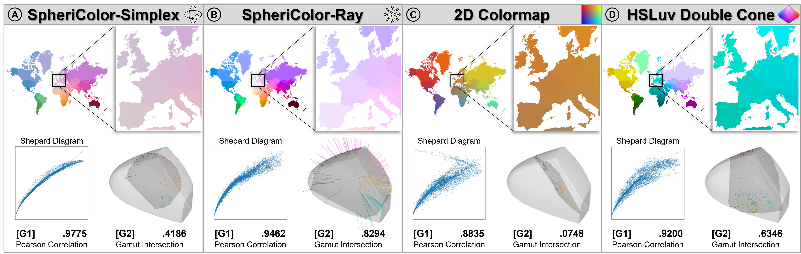

# SpheriColor

[](https://pypi.org/project/sphericolor/)
[](LICENSE)

SpheriColor is a Python implementation of the techniques introduced in the paper
*SpheriColor: Colormaps for Spherical Geospatial Input Topographies*.




Its generation pipeline computes pairwise great-circle distances, embeds them in three dimensions with metric MDS, and
maps the embedding into the displayable sRGB gamut represented in CAM16-UCS. Ray and Simplex are
the two available gamut-mapping strategies, designed to preserve distances while maximizing
color-space utilization. This can be useful for visual analytics dashboards with juxtaposed views,
where color similarity helps reveal geographic proximity across different visualizations.

## Installation

```bash
pip install sphericolor
```

SpheriColor supports Python 3.10 through 3.13.

## Geographic coordinates

```python
from sphericolor import from_latlon

labels = [
    "London", "New York", "Mexico City", "São Paulo", "Cape Town", "Nairobi",
    "Cairo", "Mumbai", "Singapore", "Tokyo", "Sydney", "Auckland",
]
latitudes = [
    51.5074, 40.7128, 19.4326, -23.5505, -33.9249, -1.2921,
    30.0444, 19.0760, 1.3521, 35.6762, -33.8688, -36.8509,
]
longitudes = [
    -0.1278, -74.0060, -99.1332, -46.6333, 18.4241, 36.8219,
    31.2357, 72.8777, 103.8198, 139.6503, 151.2093, 174.7645,
]

mapping = from_latlon(
    latitudes=latitudes,
    longitudes=longitudes,
    labels=labels,
    method="ray",
)

print(dict(zip(mapping.labels, mapping.hex)))
```

Coordinate input uses great-circle distances in kilometers for Ray and Simplex.

### Visualization of Colors

To visually check the generated colors in their geographic context, install the optional plotting
dependencies with `pip install geopandas matplotlib`:

```python
import geopandas as gpd
import matplotlib.pyplot as plt

world = gpd.read_file(
    "https://naturalearth.s3.amazonaws.com/110m_cultural/"
    "ne_110m_admin_0_countries.zip"
).to_crs("+proj=robin")
cities = gpd.GeoDataFrame(
    {"city": labels, "color": mapping.hex},
    geometry=gpd.points_from_xy(longitudes, latitudes),
    crs="EPSG:4326",
).to_crs(world.crs)

ax = world.plot(color="#eeeeee", edgecolor="#aaaaaa", figsize=(13, 7))
cities.plot(ax=ax, color=cities["color"], edgecolor="black", markersize=90)
ax.set_axis_off()
plt.show()
```

## Precomputed distances

Since SpheriColor constructs a distance matrix from geographic coordinates for Ray and Simplex,
you can bypass this step and provide a precomputed distance matrix directly:

```python
import numpy as np
from sphericolor import from_distance_matrix

distances = np.array([
    [0.0, 1.0, 2.0, 1.0],
    [1.0, 0.0, 1.0, 2.0],
    [2.0, 1.0, 0.0, 1.0],
    [1.0, 2.0, 1.0, 0.0],
])
mapping = from_distance_matrix(distances, method="simplex")
```

HSLuv and bivariate mappings require geographic coordinates because they use latitude and
longitude orientation directly.

## Methods

```python
ray = from_latlon(latitudes, longitudes, method="ray")
simplex = from_latlon(latitudes, longitudes, method="simplex")
hsluv = from_latlon(latitudes, longitudes, method="hsluv")
bivariate = from_latlon(
    latitudes,
    longitudes,
    method="bivariate",
    bivariate_map="steiger",
)
```

Available bivariate maps are `bremm`, `cube_diagonal`, `schumann`, `steiger`, `teuling2`, and
`ziegler`.

Set `diagnostics=True` to include condensed input and output distances plus intermediate MDS
embeddings. Diagnostics require quadratic memory and are disabled by default.

### Stability

Ray and Simplex derive their colors from an MDS embedding of the complete input set. Because MDS
is sensitive to the point configuration, changing the entity set may produce a different color
mapping. HSLuv and the bivariate methods provide dataset-independent alternatives when consistent
colors across datasets are needed.

## License and citation

SpheriColor and its bundled gamut asset are MIT licensed. If you use SpheriColor in academic
work, please cite the associated paper:

> Julius Rauscher, Johannes Fuchs, Daniel A. Keim, and Frederik L. Dennig. “SpheriColor:
> Colormaps for Spherical Geospatial Input Topographies.” EuroVis 2026 Short Papers, 2026.

```bibtex
@inproceedings{rauscher2026sphericolor,
  title     = {{SpheriColor}: Colormaps for Spherical Geospatial Input Topographies},
  author    = {Rauscher, Julius and Fuchs, Johannes and Keim, Daniel A. and Dennig, Frederik L.},
  booktitle = {EuroVis 2026 Short Papers},
  year      = {2026}
}
```

See `CITATION.cff` for machine-readable software and paper citation metadata.
